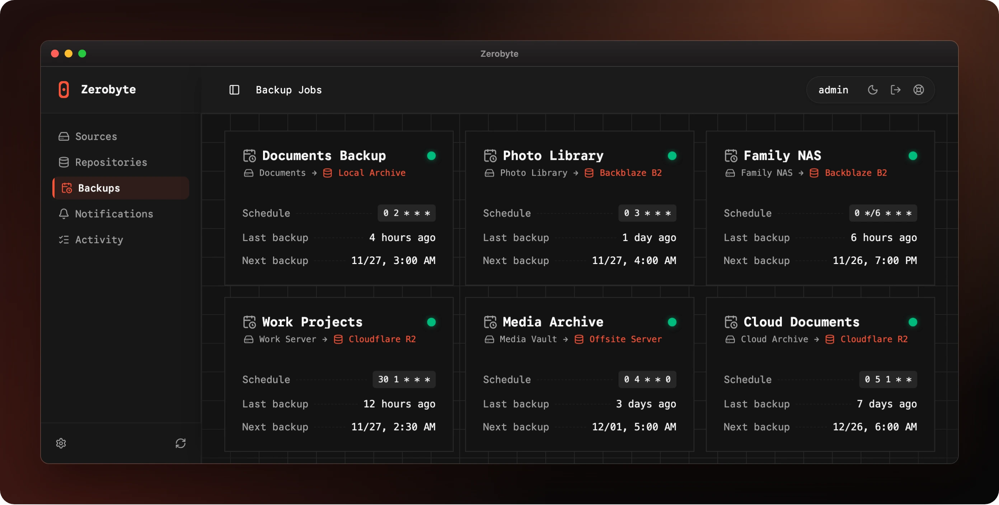
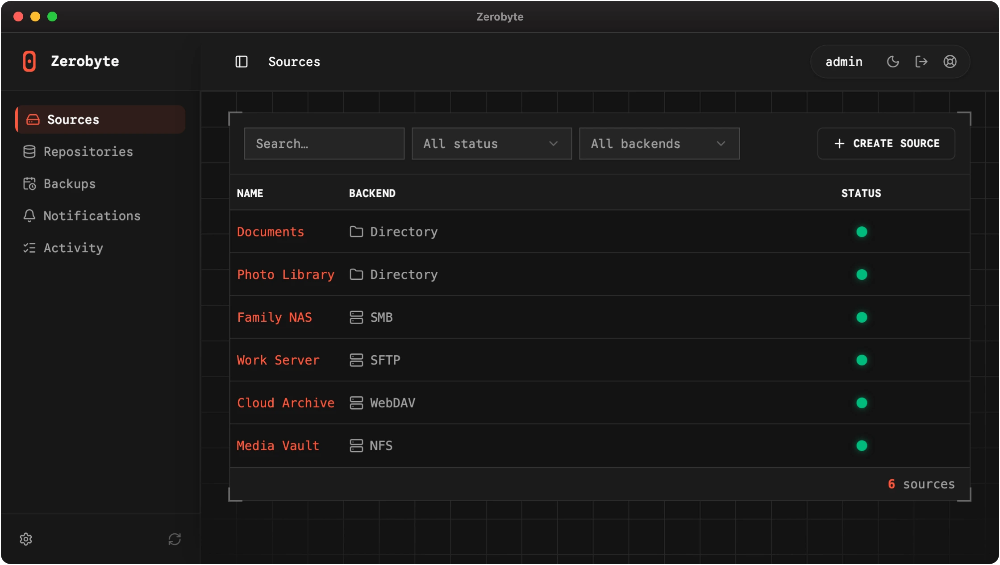
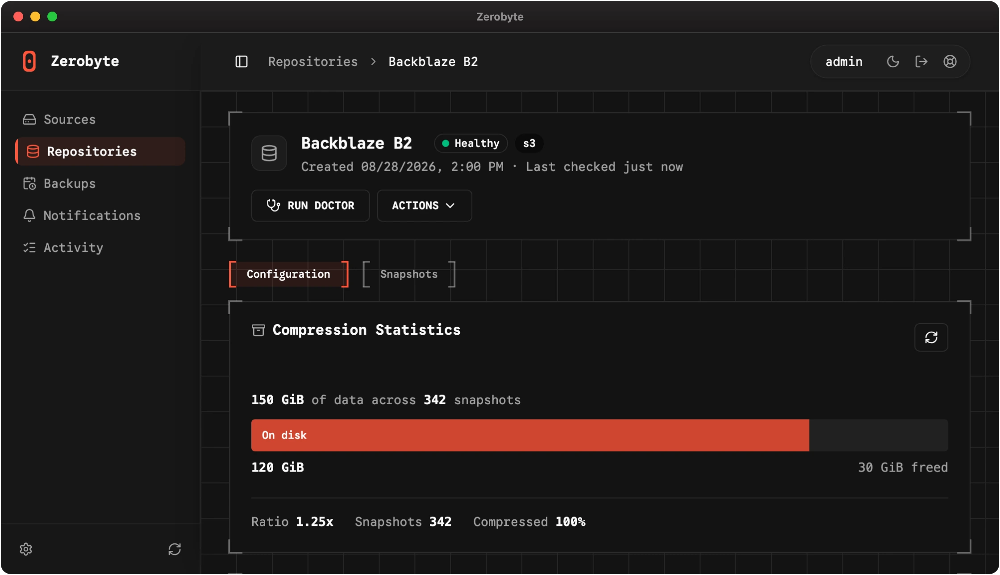
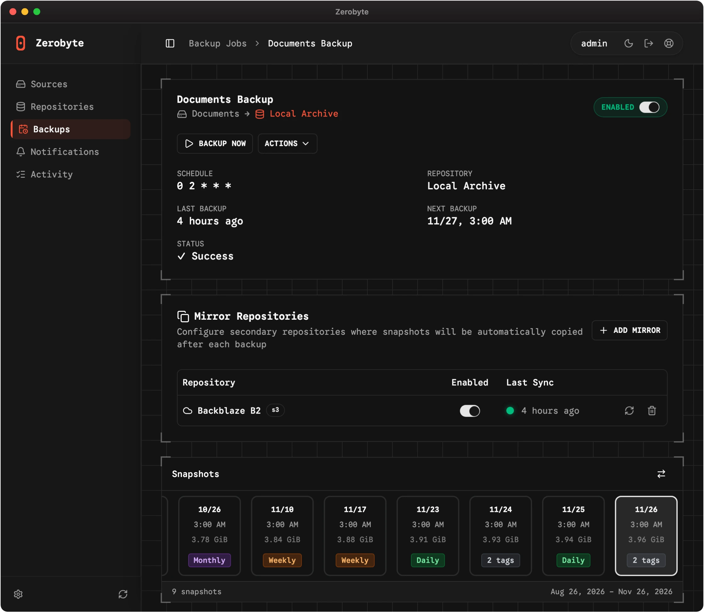
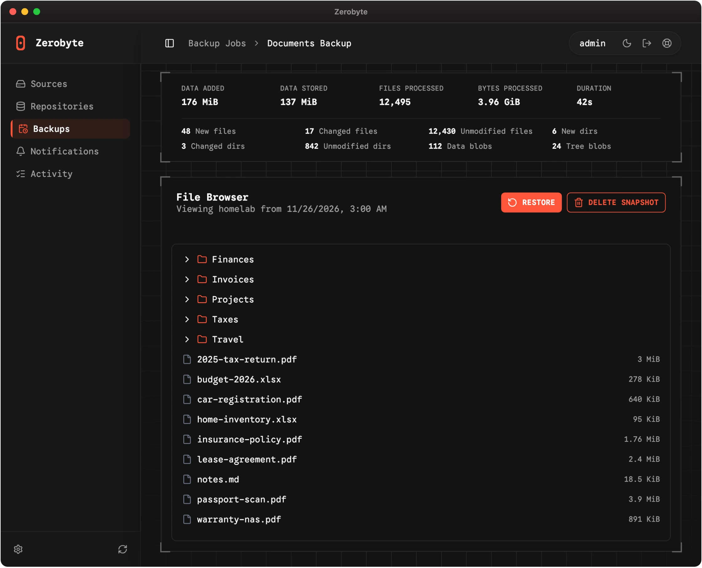

<div align="center">
  
  <h1>Zerobyte</h1>
  <p>
    <strong>Backups you can finally forget about.</strong><br />
    A clean web interface to schedule, monitor, restore and maintain encrypted backups across local disks, NAS shares, remote servers and cloud storage. Self-hosted, open source and powered by Restic.
  </p>
  <p>
    <a href="https://zerobyte.app"><strong>Documentation</strong></a> ·
    <a href="https://zerobyte.app/docs/quickstart"><strong>Quick start</strong></a> ·
    <a href="https://discord.gg/XjgVyXrcEH"><strong>Discord</strong></a> ·
    <a href="https://github.com/nicotsx/zerobyte/issues"><strong>Issues</strong></a>
  </p>
  <p>
    <a href="https://github.com/nicotsx/zerobyte/releases"></a>
    <a href="https://github.com/nicotsx/zerobyte/blob/main/LICENSE"></a>
    <a href="https://discord.gg/XjgVyXrcEH"></a>
    <a href="https://github.com/nicotsx/zerobyte/stargazers"></a>
  </p>
  <p>
    <a href="https://www.buymeacoffee.com/nicotsx"></a>
  </p>
  <br />
  
</div>

<br />

## Why Zerobyte

[Restic](https://restic.net) is excellent at creating secure, efficient backups. Zerobyte builds on it with a control plane that manages the whole backup lifecycle from one place.

- **You keep** Restic's encryption, deduplication and incremental snapshots, and your choice of storage backend.
- **You gain** scheduling, monitoring, restores, repository maintenance and team access controls.

Your backups stay standard Restic repositories, so you can always open them with the Restic CLI, with or without Zerobyte.

## Features

### Back up from anywhere

Local directories, NAS shares over NFS or SMB, WebDAV, SFTP and rclone remotes. Zerobyte mounts your shares, monitors their health and remounts them if they disconnect.



### Keep it wherever you want

A local disk, S3-compatible storage, Cloudflare R2, Google Cloud Storage, Azure Blob Storage, a REST server, an SFTP target, or one of the 40+ providers supported by rclone. Restic encrypts, deduplicates and compresses your data before it leaves your server, so your storage provider never sees plaintext.



### Schedule once, stay protected

Define when backups run, how long snapshots are kept, and which paths to include or exclude. Mirror repositories copy your snapshots to additional locations, for a 3-2-1 strategy or provider redundancy.



### Restore in a few clicks

Browse any snapshot from the web interface and restore individual files, directories or larger paths, to their original location or somewhere else.



### And more

- **Notifications** by email, Slack, Discord, ntfy, Gotify, Pushover, Telegram or a custom webhook
- **Teams and SSO** with organizations, OIDC, two-factor authentication and passkeys
- **Automation** through pre and post backup webhooks, API keys and resources provisioned from a file
- **Repository maintenance** to run Doctor, unlock stale repositories and refresh statistics from the interface

## Get started

You need Docker and Docker Compose. Create a `compose.yaml` file:

```yaml
services:
  zerobyte:
    image: ghcr.io/nicotsx/zerobyte:v0.44
    container_name: zerobyte
    restart: unless-stopped
    cap_add:
      - SYS_ADMIN
    ports:
      - "4096:4096"
    devices:
      - /dev/fuse:/dev/fuse
    environment:
      - TZ=Europe/Zurich # Your timezone, used for backup schedules
      - BASE_URL=http://localhost:4096 # The URL you will use to open Zerobyte
      - APP_SECRET=94bad46...c66e25d5c2b # Generate your own with `openssl rand -hex 32`
    volumes:
      - /etc/localtime:/etc/localtime:ro
      - /var/lib/zerobyte:/var/lib/zerobyte
```

Start it and open `http://<your-server-ip>:4096` to create your admin account:

```bash
docker compose up -d
```

> [!WARNING]
> Do not expose Zerobyte directly to the internet. On a public server, bind the port to `127.0.0.1` and reach it through an authenticated tunnel or reverse proxy.

Only backing up local folders? There is a [reduced-privilege setup](https://zerobyte.app/docs/installation#simplified-installation-no-remote-mounts) without `SYS_ADMIN`. The [installation guide](https://zerobyte.app/docs/installation) also covers mounting host directories, TrueNAS and the other deployment options.

## Documentation

Everything else lives on [zerobyte.app](https://zerobyte.app):

- [Quick start](https://zerobyte.app/docs/quickstart), your first backup in a few minutes
- [Configuration](https://zerobyte.app/docs/configuration), environment variables and advanced options
- Guides for [3-2-1 backups](https://zerobyte.app/docs/guides/3-2-1-backup-strategy), [rclone](https://zerobyte.app/docs/guides/rclone), [reverse proxies](https://zerobyte.app/docs/guides/reverse-proxy), [SSO](https://zerobyte.app/docs/guides/oidc-sso), [notifications](https://zerobyte.app/docs/guides/notifications) and more
- [Troubleshooting](https://zerobyte.app/docs/troubleshooting), solutions to common issues
- [Examples](examples/README.md), ready to copy Docker Compose setups

> [!NOTE]
> Zerobyte is still in version 0.x and may change significantly between releases. Feedback, bug reports and feature requests are very welcome.

## Community

Come say hi on [Discord](https://discord.gg/XjgVyXrcEH), or open an [issue](https://github.com/nicotsx/zerobyte/issues) if you found a bug or have an idea.

Contributions are welcome. Have a look at [CONTRIBUTING.md](CONTRIBUTING.md) for the development setup and the Contributor License Agreement. To report a vulnerability, follow [SECURITY.md](SECURITY.md).

## Support the project

Zerobyte is free, open source and built in my spare time. If it protects your data and you want to say thanks, a coffee goes a long way and keeps the project moving.

<a href="https://www.buymeacoffee.com/nicotsx"></a>

Starring the repository and telling a friend about it helps just as much.

## License

Zerobyte is released under the [AGPL-3.0 license](LICENSE). It includes [Restic](https://github.com/restic/restic), distributed unchanged under the BSD 2-Clause license. See [NOTICES.md](NOTICES.md) for all third-party attributions.
